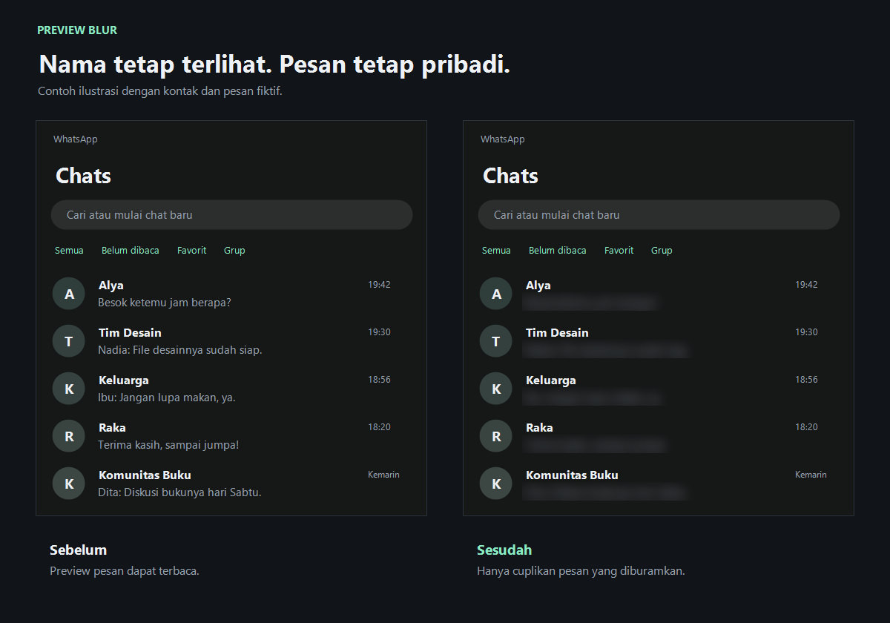
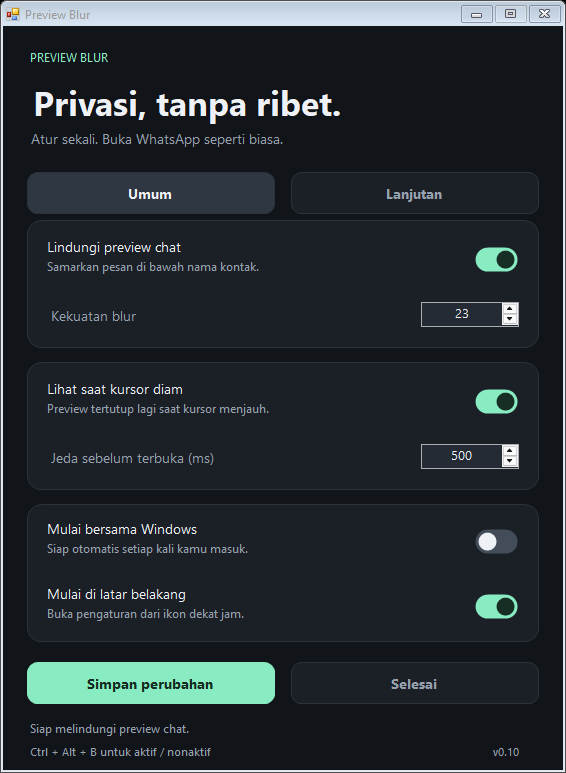

# Preview Blur

Alat privasi Windows untuk memburamkan cuplikan pesan pada daftar chat WhatsApp Desktop.

## Contoh hasil blur



Ilustrasi dengan kontak dan pesan fiktif, menggunakan algoritma blur aplikasi. Nama kontak tetap terlihat; hanya cuplikan pesan yang diburamkan.

## Pengaturan



## Pemakaian

Jalankan aplikasi. Secara bawaan, aplikasi langsung masuk ke ikon dekat jam Windows. Klik dua kali ikon tersebut untuk membuka pengaturan.

- **Umum:** aktifkan blur, atur kekuatan dan jeda hover, serta pilih perilaku saat masuk Windows.
- **Lanjutan:** deteksi lebar sidebar dan baris preview, serta kalibrasi manual jika diperlukan.
- Klik **Simpan perubahan** untuk menyimpan preferensi dan pengaturan mulai bersama Windows.
- Pilih **Keluar** dari menu ikon untuk menghentikan aplikasi.

Jeda hover bawaan adalah 500 ms. Pergerakan kursor, pergeseran baris, dan perubahan isi preview mengulang jeda tersebut.

## Build

Memerlukan Windows dengan compiler .NET Framework 4.x pada folder Framework64. Tidak menggunakan paket tambahan.

```powershell
.\build.ps1
```

Hasil: `PreviewBlur.exe`. Implementasi antarmuka berada di `src/ModernControls.cs`; runtime dan pengaturan berada di `src/PreviewBlur.cs`.

```powershell
.\PreviewBlur.exe --settings  # Buka panel pengaturan
.\PreviewBlur.exe --tray      # Mulai tanpa menampilkan panel
.\PreviewBlur.exe --self-test # Periksa deteksi dan logika hover
.\PreviewBlur.exe --test-tray # Periksa startup tanpa panel
```

## Cara kerja dan batasan

Aplikasi memproses gambar layar secara lokal untuk menemukan dan memburamkan baris preview. Gambar chat tidak disimpan atau dikirim ke layanan lain. Preferensi disimpan di `settings.txt` di samping aplikasi. Pilihan mulai bersama Windows menggunakan entri `PreviewBlur` pada Run milik pengguna saat ini.

Lapisan blur mengikuti jendela WhatsApp dan mengecualikan bagian yang tertutup aplikasi lain. Deteksi tampilan bersifat heuristik, sehingga perubahan tampilan WhatsApp dapat memerlukan penyesuaian. Mode manual menggunakan posisi baris tetap.

Blur ditujukan untuk privasi pada layar fisik. Screenshot dan berbagi layar dapat menampilkan cuplikan asli karena lapisan blur dikecualikan dari capture.

Proyek independen; tidak berafiliasi dengan WhatsApp atau Meta.

Build, preferensi pribadi, gambar pratinjau lokal, dan hasil diagnostik dikecualikan melalui `.gitignore`. Tentukan lisensi proyek sebelum membagikannya sebagai perangkat lunak sumber terbuka.

## Struktur folder

```text
src/                 Kode aplikasi dan antarmuka
tools/               Alat pengukuran performa
docs/                Pratinjau dan panduan GitHub
build.ps1            Perintah build
PreviewBlur.exe      Aplikasi terbaru (lokal, tidak masuk Git)
settings.txt         Preferensi pribadi (tidak masuk Git)
```

Panduan publikasi: [Push ke GitHub](docs/GITHUB.md).
